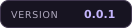
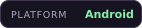
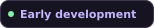
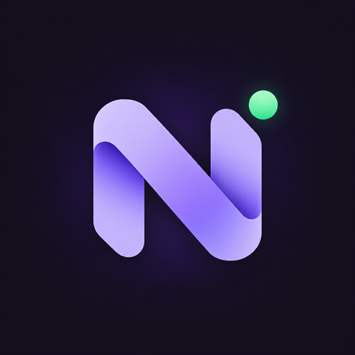

<p align="center">
  <a href="https://github.com/Nitracord/Nitracord">
    
  </a>
</p>

<h1 align="center">Nitracord</h1>

<p align="center">
  <strong>A modular Discord client for Android.</strong><br>
  Patch locally. Add your plugins. Choose your theme.
</p>

<p align="center">
  
  
  
</p>

<p align="center">
  <a href="#make-it-yours">Features</a> &nbsp;·&nbsp;
  <a href="#the-nitracord-project">Repositories</a> &nbsp;·&nbsp;
  <a href="#get-started">Get started</a> &nbsp;·&nbsp;
  <a href="#create-plugins">Create plugins</a> &nbsp;·&nbsp;
  <a href="#patch-updates">Patch updates</a> &nbsp;·&nbsp;
  <a href="#contribute">Contribute</a>
</p>

---

## Make it yours

<table>
  <tr>
    <td width="33%" align="center">
      
      <h3>Patch on your terms</h3>
      <p>Build a signed client from an original APK, APKM, APKS or AAB, on Android or desktop.</p>
    </td>
    <td width="33%" align="center">
      
      <h3>Add your extensions</h3>
      <p>Browse and install plugins from Nitracord settings, or import a JavaScript file.</p>
    </td>
    <td width="33%" align="center">
      
      <h3>Find your look</h3>
      <p>Browse and install themes, use Midnight, or return to Discord default. Figtree works offline.</p>
    </td>
  </tr>
  <tr>
    <td align="center">
      
      <h3>Choose your patches</h3>
      <p>Select supported metrics and telemetry patches, with individual rule exclusions.</p>
    </td>
    <td align="center">
      
      <h3>Refresh your bundle</h3>
      <p>Fetch validated patch recipes and client payloads. Keep a cached bundle for offline use.</p>
    </td>
    <td align="center">
      
      <h3>One shared engine</h3>
      <p>The app and CLI use the same core, with independent repos for patches and extensions.</p>
    </td>
  </tr>
</table>

## The Nitracord project

This repository is the project hub. The core, frontends, patches, plugins and themes each have their own Git repository.

| Component                                                                                                                        | What lives here                                                        | Local checkout            |
| -------------------------------------------------------------------------------------------------------------------------------- | ---------------------------------------------------------------------- | ------------------------- |
|  [Project hub](https://github.com/Nitracord/Nitracord)               | Documentation, branding and source packaging                           | `.`                       |
|  [Patcher core](https://github.com/Nitracord/nitracord-patcher-core) | APK processing, generic DEX/manifest edits, signing and bundle loading | `nitracord-patcher-core/` |
|  [Patcher app](https://github.com/Nitracord/nitracord-patcher-app)    | Android patching UI and device signing                                 | `nitracord-patcher-app/`  |
|  [Patcher CLI](https://github.com/Nitracord/nitracord-patcher-cli) | Desktop command line frontend                                          | `nitracord-patcher-cli/`  |
|  [Patches](https://github.com/Nitracord/nitracord-patches)           | OTA recipes, privacy targets and the injected runtime                  | `nitracord-patches/`      |
|  [Plugins](https://github.com/Nitracord/nitracord-plugins)           | Importable JavaScript extensions and catalog                           | `nitracord-plugins/`      |
|  [Themes](https://github.com/Nitracord/nitracord-themes)            | Importable JSON themes and catalog                                     | `nitracord-themes/`       |

The organization profile is maintained in [Nitracord/.github](https://github.com/Nitracord/.github). Checkout paths and remotes are recorded in [repositories.json](repositories.json). Component checkouts are ignored by the hub's Git repository.

## Get started

Keep the component folders in the layout above. Use **JDK 17+** and each checkout's Gradle wrapper. The Android build also needs **Android SDK 35**; SDK 36 works with `-PandroidCompileSdk=36`.

### Desktop patcher

From `nitracord-patcher-cli/`:

```sh
./gradlew build installDist
build/install/nitracord-patcher-cli/bin/nitracord-patcher-cli --help
```

The distributable ZIP is written to `build/distributions/`.

### Android patcher

From `nitracord-patcher-app/`:

```sh
./gradlew :app:assembleDebug
```

The debug APK is written to `app/build/outputs/apk/debug/app-debug.apk`.

<details>
<summary><strong>Windows commands and custom checkout locations</strong></summary>

From the CLI checkout:

```powershell
.\gradlew.bat build installDist
.\build\install\nitracord-patcher-cli\bin\nitracord-patcher-cli.bat --help
```

From the Android checkout:

```powershell
.\gradlew.bat :app:assembleDebug
```

Both frontends include the independent core through a Gradle composite build. Override its path with `-PcoreDir=/path/to/patcher-core` and the offline bundle source with `-PpatchesDir=/path/to/patches`.

The built APK and CLI distribution run without the source checkouts.

</details>

## Create plugins

Build extensions with Nitracord's shared bridge for account/chat context, message events, typing controls and scoped storage.

- [Plugin author guide](https://github.com/Nitracord/nitracord-plugins/blob/main/docs/creating-plugins.md) — setup, metadata, UI, storage, cleanup and publishing.
- [Bridge API reference](https://github.com/Nitracord/nitracord-plugins/blob/main/docs/bridge-api.md) — public APIs and compatibility requirements.
- [Working plugin example](https://github.com/Nitracord/nitracord-plugins/blob/main/examples/channel-activity.js) — a complete plugin with a screen and message subscription.

## Patch updates

Privacy targets, class fingerprints, manifest selectors, diagnostics and tested Discord baselines live in **[patches](https://github.com/Nitracord/nitracord-patches)**. The shared core provides generic operations to apply those definitions.

The patches repo builds `bundles/default.ncp` and its `index.json`. The app's **Check for patch updates** action and the CLI both validate downloaded bundles before replacing the cache. Each frontend also includes an offline fallback.

```sh
nitracord-patcher-cli --list-patches
nitracord-patcher-cli --update-patches
```

An update applies to the **next APK you produce**. Patch and install the client again to use it. New engine operation kinds require a core/frontend release.

<details>
<summary><strong>OTA endpoint and bundle contents</strong></summary>

Official index: `https://raw.githubusercontent.com/Nitracord/nitracord-patches/main/index.json`.

The endpoint serves updates once the generated index and bundle are published to the patches repo. Local builds do not publish them.

Bundles contain declarative recipes, the Android/JavaScript runtime, the offline font and applicable notices. The patchers check payload hashes, schema and engine API compatibility before caching a bundle. Failed validation preserves the previous working cache.

</details>

## Contribute

| Guide                                      | Start here                                         |
| ------------------------------------------ | -------------------------------------------------- |
| [Development](CONTRIBUTING.md)             | Formatting, component checks and bundle generation |
| [Source layout](SOURCE-LAYOUT.md)          | Packages and repository responsibilities           |
| [Tests and checks](CONTRIBUTING.md#checks) | Component checks and test coverage                 |
| [Brand assets](assets/branding/README.md)  | Icons, banners and GitHub exports under 1 MB       |

Run `./gradlew check` from this hub to check the core against the local patch bundle. JavaScript tooling requires Node 18+; bundle/source tooling uses Python 3.

### Export the sources

```sh
python tools/export-source.py
```

This creates `dist/Nitracord-source-0.0.1.zip` from the hub and its component checkouts. Git metadata, build outputs, SDK paths, caches and signing keys are excluded.

<details>
<summary><strong>Versions and package names</strong></summary>

All Nitracord components start at **0.0.1**. Android versionCode is **1**. Dependency releases, Discord build numbers and schema/API versions remain independent.

| Interface                | Identifier              |
| ------------------------ | ----------------------- |
| Android patcher          | `app.nitracord.patcher` |
| Alongside client default | `com.discord.nitracord` |
| JavaScript plugin API    | `Nitracord`             |
| Plugin metadata          | `NitracordPlugin`       |
| Client assets            | `assets/nitracord/`     |

</details>

## Credits and licensing

Applicable dependency notices and original copyright attributions are retained in the component repos. Plugins and themes include their applicable MIT licenses. A license for the project-wide original source has not been selected.

---

<p align="center">
  <br>
  <sub>Nitracord · Android client · 0.0.1</sub>
</p>
