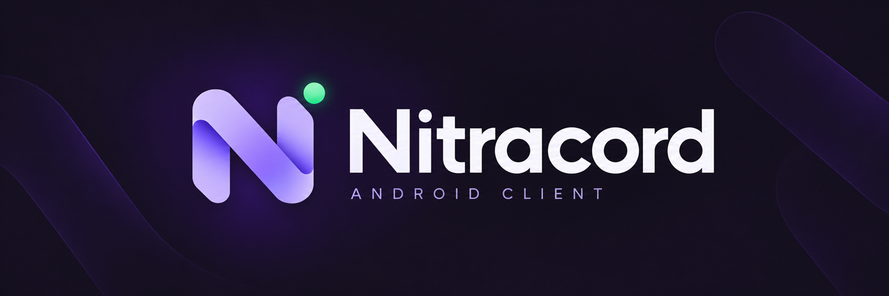

# Nitracord brand assets

Icons and banners for Nitracord, featuring a lavender ribbon N, mint status dot and dark plum background.

## GitHub-ready images

Each PNG below is **under 1,000,000 bytes**, including the social preview. The main README uses these smaller exports.

| Asset                                               | Dimensions | File size     | Use                                 |
| --------------------------------------------------- | ---------- | ------------- | ----------------------------------- |
| [Icon](github/nitracord-icon.png)                   | 512 × 512  | 260,655 bytes | Organization avatar or profile icon |
| [Main banner](github/nitracord-banner.png)          | 1536 × 512 | 791,228 bytes | README and wide project headers     |
| [Social banner](github/nitracord-social-banner.png) | 1280 × 640 | 896,791 bytes | Repository/social preview           |



Regenerate the exports on Windows from the main project root:

```powershell
.\tools\export-branding.ps1
```

The exporter resizes the original artwork with high-quality interpolation and preserves PNG output. It checks the byte limit before finishing.

<details>
<summary><strong>Full-size original artwork</strong></summary>

| Asset                                        | Dimensions  |
| -------------------------------------------- | ----------- |
| [Icon](nitracord-icon.png)                   | 1254 × 1254 |
| [Main banner](nitracord-banner.png)          | 2172 × 724  |
| [Social banner](nitracord-social-banner.png) | 1774 × 887  |

These master files exceed 1 MB; use the GitHub-ready versions for uploads with a 1 MB limit. All files are opaque RGB PNGs. The icon has a square background with margins for circular crops.

</details>

Palette direction: dark plum `#15121F`, lavender `#C4B5FD`, violet shading and mint `#86EFAC`. The artwork includes no release number so it can be reused across Nitracord releases.

Small SVG icons and badges for the README live in `assets/readme/`. They are local assets, so the README does not depend on a badge service.

Export packages:

- `dist/Nitracord-GitHub-Branding-0.0.1.zip`: three GitHub-ready PNGs, each under 1 MB.
- `dist/Nitracord-Branding-0.0.1.zip`: complete branding set, originals and exports.
